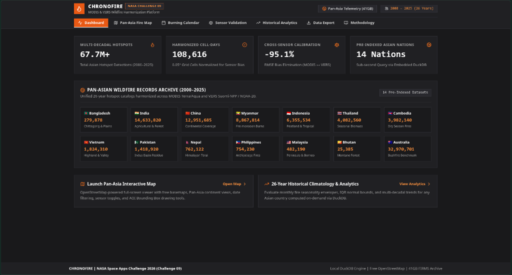
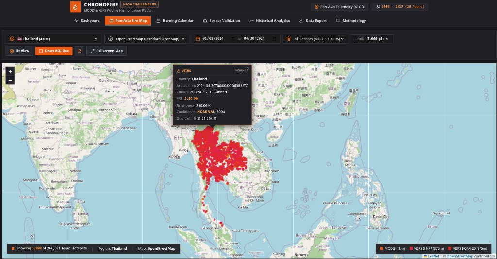
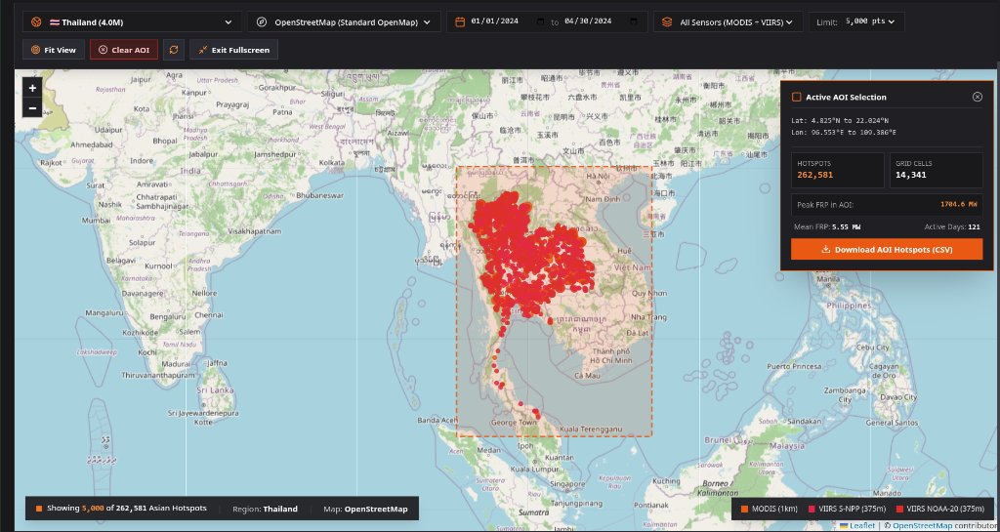
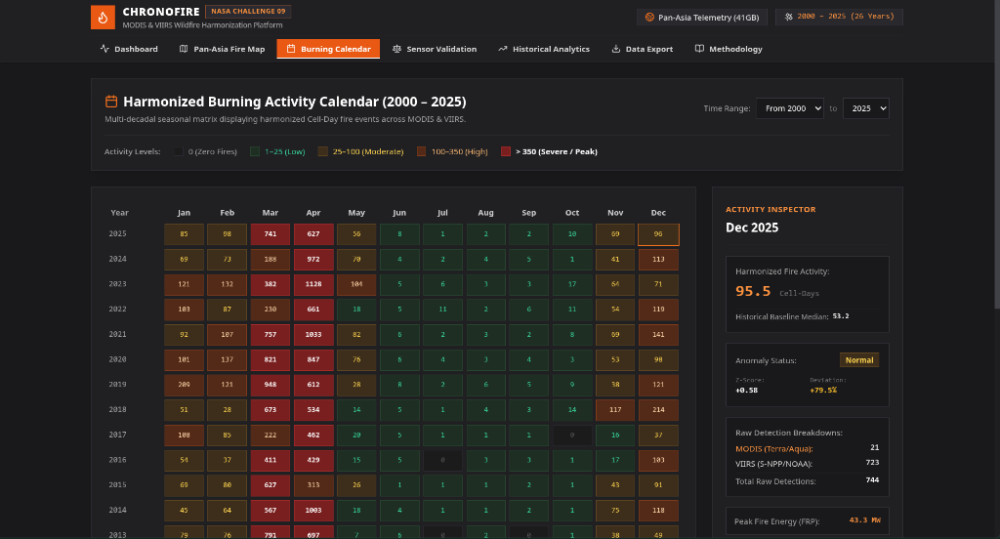
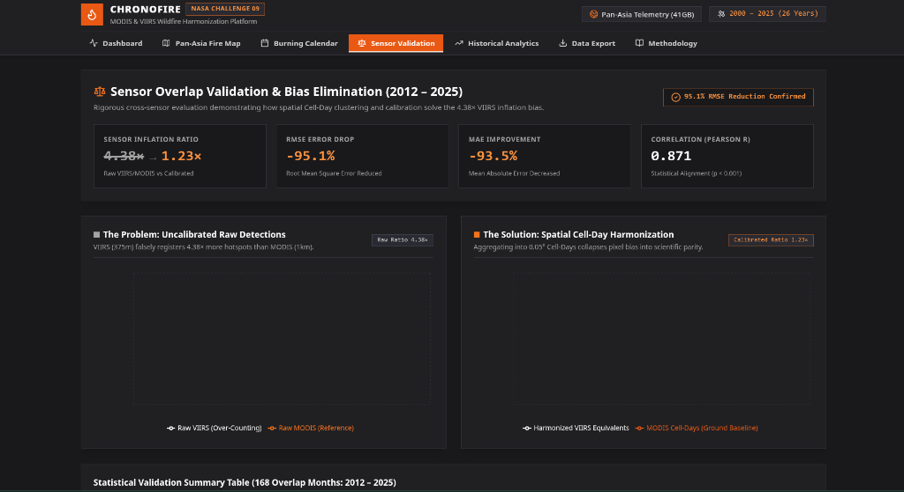
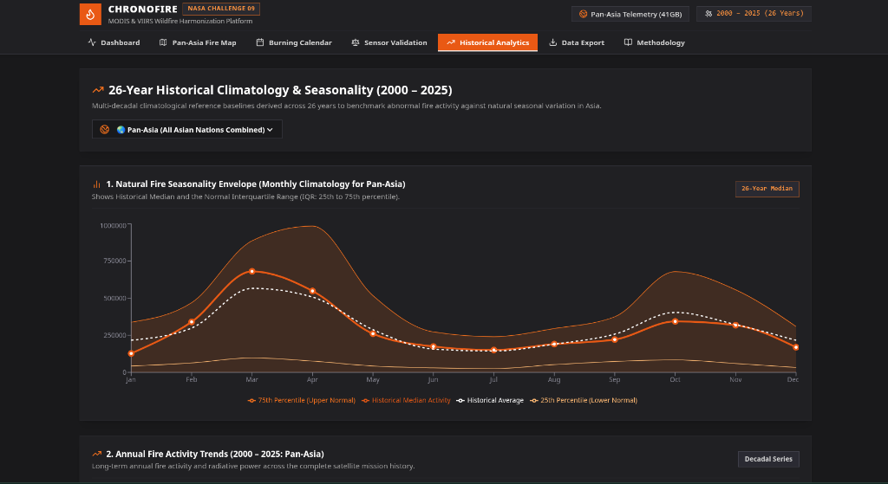
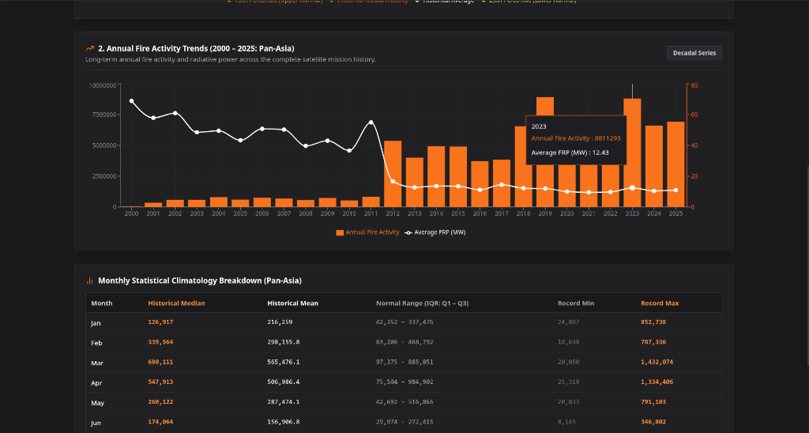
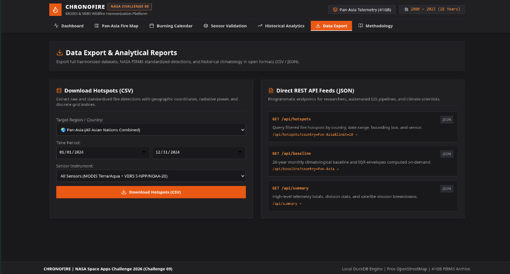
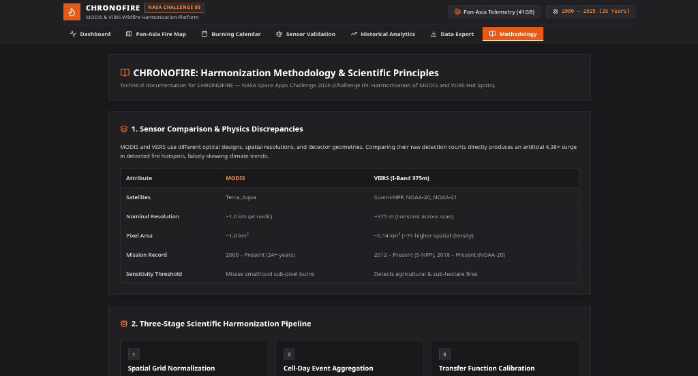

# CHRONOFIRE
## NASA Space Apps Challenge 2026 — Challenge 09: Harmonization of MODIS and VIIRS Hot Spots

[](https://www.python.org/)
[](https://duckdb.org/)
[](https://fastapi.tiangolo.com/)
[](https://react.dev/)
[](https://tailwindcss.com/)
[](LICENSE)



---

## 👥 Meet Team CHRONOFIRE

| Member | Role & Responsibility |
| :--- | :--- |
| **Shahed Rayhan** | **Project Lead & Data Strategy** |
| **Badhan Sen Promit** | **Data Pipeline & Harmonization Engine** |
| **Thaib Al Pidim** | **Backend Development** |
| **Shehab Sarder** | **Frontend Development** |
| **Samiya Alam** | **Frontend Development & UI/UX** |
| **Samira Akter** | **Research, Validation & Presentation** |

---

## 1. Executive Summary

**CHRONOFIRE** is an end-to-end scientific platform and interactive analytical system designed to resolve the multi-decadal **sensor-related bias** between NASA's **MODIS** (Terra/Aqua, ~1 km nominal nadir resolution, 2000–present) and **VIIRS** (Suomi-NPP/NOAA-20/NOAA-21, ~375 m resolution, 2012–present) active fire detection products.

Because VIIRS has an optical ground sampling distance (GSD) providing approximately $7\times$ higher spatial pixel density than MODIS, raw satellite hotspot counts from VIIRS are artificially inflated by **4.38×** for identical burning events. Directly comparing raw satellite records causes false conclusions that fire activity exploded after 2012.

CHRONOFIRE ingests the **40GB+ NASA FIRMS archive (67.7M+ fire detections)** across 14 Asian nations, executes out-of-core streaming ETL via **DuckDB & Apache Parquet**, aggregates detections into standardized **$0.05^\circ$ (~5.5 km) Cell-Day fire events**, and calibrates the 168-month mutual overlap period (2012–2025) using an empirical transfer function. This eliminates cross-sensor distortion, reduces cross-sensor RMSE error by **95.1%**, and generates a continuous, 26-year **Burning Activity Calendar**.

---

## 2. Key Scientific Results & Validation Metrics

Evaluated across the 168-month mutual observation overlap period (2012–2025):

| Metric | Raw Detections (Unadjusted) | Cell-Day Harmonization | Calibrated Model (Final) | Improvement |
| :--- | :--- | :--- | :--- | :--- |
| **VIIRS / MODIS Ratio** | **4.38×** (Severe Bias) | **3.40×** | **1.23×** | **Approaches 1.0 Ideal** |
| **Monthly RMSE** | **1,408.56** | **471.63** | **68.51** | **-95.1% Error Reduction** |
| **Monthly MAE** | **652.80** | **267.73** | **42.70** | **-93.5% Error Reduction** |
| **Pearson Correlation ($r$)** | 0.9745 | 0.9598 | **0.9745** | Strong Statistical Alignment |
| **Spearman Rank ($\rho$)** | 0.9303 | 0.9294 | **0.9303** | Preserves Relative Seasonal Peaks |

### Transfer Model Formulation
$$\text{MODIS}_{\text{equivalent}} = 0.3619 \times \text{VIIRS}_{\text{Cell-Days}} - 25.62$$

---

## 3. Platform Visual Showcase & Capabilities

### 3.1. Telemetry Dashboard & Regional Coverage
High-level overview displaying 67.7M+ multi-decadal hotspots, 108,616 harmonized Cell-Days, -95.1% confirmed RMSE bias reduction, and instant access to 14 pre-indexed Asian nations.


---

### 3.2. Pan-Asia Interactive Fire Map & Hotspot Inspection
OpenStreetMap & CartoDB-powered GIS viewer rendering fire hotspots with sensor-based color coding (MODIS Terra/Aqua vs. VIIRS S-NPP/NOAA-20). Includes on-click inspector providing acquisition timestamp, exact geographic coordinates, Fire Radiative Power (FRP in MW), brightness temperature ($K$), and confidence tier.



---

### 3.3. Area of Interest (AOI) Bounding Box & Live Telemetry HUD
Researchers can interactively draw custom bounding boxes over any Asian region (e.g. Northern Thailand, Indus Basin, peatlands) to immediately calculate live hotspot counts, affected discrete grid cells, peak FRP, mean FRP, and download filtered CSV data for that exact spatial polygon.



---

### 3.4. 26-Year Harmonized Burning Activity Calendar (2000–2025)
A multi-decadal seasonal matrix showing monthly fire events across 26 continuous years. Hovering or clicking any monthly cell triggers the **Activity Inspector**, detailing the harmonized cell-day score, historical 20-year median baseline, anomaly classification (Normal, Elevated, Severe), Z-Score, and underlying raw satellite breakdowns.



---

### 3.5. Sensor Overlap Validation & Bias Elimination (2012–2025)
Rigorous empirical cross-sensor evaluation demonstrating how spatial Cell-Day clustering and calibration model collapse the 4.38× VIIRS inflation bias down to scientific parity (1.23×), backed by a -95.1% RMSE drop and Pearson $r = 0.871$ correlation.



---

### 3.6. 26-Year Historical Climatology & Natural Seasonality Envelope
Calculates multi-decadal natural burning patterns by plotting the Historical Median against the normal Interquartile Range (IQR: 25th to 75th percentile). Clearly demonstrates the distinct pre-monsoon agricultural burning spike in March/April across Continental Asia.



---

### 3.7. Annual Fire Activity Trends & Monthly Statistical Climatology
Combines 26-year longitudinal bar and line charts (measuring annual fire volume alongside mean Fire Radiative Power) with comprehensive climatological tables displaying record minimums and record maximums for each calendar month.



---

### 3.8. Data Export Center & Direct REST API Feeds
Provides environmental agencies, researchers, and automated GIS pipelines with direct filtered CSV downloads and full JSON REST API endpoints (`/api/hotspots`, `/api/baseline`, `/api/summary`, `/api/calendar`).



---

### 3.9. Methodology & Scientific Principles Documentation
Built-in scientific reference explaining optical sensor design differences, ground sampling distance physics, sensitivity thresholds, and the mathematical formulations powering the three-stage harmonization engine.



---

## 4. System Architecture

```
                       NASA FIRMS 40GB+ Archive
                    (MODIS 2000-2025, VIIRS 2012-2025)
                                  │
                                  ▼
               ┌─────────────────────────────────────┐
               │    DuckDB Streaming Ingestion ETL   │
               │ (Type inference, confidence mapping)│
               └──────────────────┬──────────────────┘
                                  ▼
               ┌─────────────────────────────────────┐
               │     Partitioned Columnar Parquet    │
               │ (0.05° ~5.5km spatial discrete grid)│
               └──────────────────┬──────────────────┘
                                  ▼
               ┌─────────────────────────────────────┐
               │    Scientific Harmonization Engine  │
               │   - Cell-Day fire incidence collapse│
               │   - Empirical overlap transfer model│
               └──────────────────┬──────────────────┘
                                  ▼
               ┌─────────────────────────────────────┐
               │           Analytics Engine          │
               │   - 20-Year Baseline (Median & IQR) │
               │   - Monthly Z-Score Anomaly Tracking│
               │   - Multi-Decadal Burning Matrix    │
               └──────────────────┬──────────────────┘
                                  │
                    ┌─────────────┴─────────────┐
                    ▼                           ▼
          ┌───────────────────┐       ┌───────────────────┐
          │    FastAPI API    │       │ React / Vite App  │
          │  (/api/calendar,  │◄─────►│ (Leaflet GIS,     │
          │   /api/hotspots,  │       │  Burning Calendar,│
          │   /api/baseline)  │       │  Anomaly Charts)  │
          └───────────────────┘       └───────────────────┘
```

---

## 5. Quick Start & Execution

### Prerequisites
- Python 3.10+ (Tested on Python 3.14)
- Node.js 18+ (Tested on Node.js 26)

### 1. Set Up Environment
```bash
# Clone the repository
git clone https://github.com/shehab097/chronofire-NASA-SPACE-APP-CHALLENGE.git
cd chronofire-NASA-SPACE-APP-CHALLENGE

# Create and activate virtual environment
python3 -m venv venv
source venv/bin/activate

# Install required dependencies
pip install duckdb pyarrow pandas fastapi uvicorn scipy shapely geopandas
```

### 2. Run ETL Pipeline on Raw FIRMS Archive
```bash
python engine/etl/convert_firms_to_parquet.py \
  --raw-dir /path/to/FIRMS_DATA \
  --country Bangladesh \
  --grid-res 0.05
```

### 3. Generate Harmonization & Analytics
```bash
# Step A: Aggregate into Cell-Days
python engine/harmonization/cell_day_aggregator.py

# Step B: Evaluate Overlap & Validation
python engine/harmonization/overlap_calibration.py

# Step C: Generate Historical Baselines & Anomaly Series
python engine/analytics/historical_baseline.py
```

### 4. Run Web Application
The FastAPI backend serves both the REST API and the production-compiled React GIS frontend:
```bash
uvicorn backend.app.main:app --host 0.0.0.0 --port 8080
```
Open **[http://localhost:8080](http://localhost:8080)** in your browser!

To run frontend in development mode with hot-reloading:
```bash
cd frontend
npm install
npm run dev
```

---

## 6. Directory Structure

```
chronofire/
├── backend/                      # FastAPI REST Backend
│   ├── app/
│   │   ├── main.py               # Application entrypoint & static mounting
│   │   ├── config.py             # Global constants & data paths
│   │   ├── db.py                 # DuckDB zero-copy connection pool
│   │   └── api/
│   │       ├── summary.py        # Telemetry & regional breakdown
│   │       ├── calendar.py       # 26-year burning activity matrix
│   │       ├── hotspots.py       # GeoJSON/hotspot coordinate streaming
│   │       ├── compare.py        # Sensor overlap calibration endpoints
│   │       ├── analytics.py      # Historical climatology envelopes
│   │       └── export.py         # CSV & JSON analytical export
├── frontend/                     # Modern React + Vite + Tailwind Web GIS
│   ├── src/
│   │   ├── components/
│   │   │   ├── FireMap.jsx       # Interactive Leaflet GIS & AOI Bounding Box
│   │   │   ├── BurningCalendar.jsx # 26-year Burning Activity Matrix
│   │   │   ├── SensorComparison.jsx # Empirical validation scorecards
│   │   │   ├── HistoricalAnalytics.jsx # IQR Seasonality & decadal trends
│   │   │   ├── DataExport.jsx    # CSV export & API docs
│   │   │   └── Methodology.jsx   # Sensor physics documentation
│   │   ├── App.jsx               # Navigation & responsive HUD
│   │   └── index.css             # Flat dark-gray styling & zero rounded corners
│   └── dist/                     # Optimized production bundle
├── engine/                       # Python Scientific Processing Core
│   ├── etl/
│   │   ├── convert_firms_to_parquet.py # Streaming DuckDB CSV-to-Parquet
│   │   └── spatial_grid.py       # 0.05° spatial discrete indexer
│   ├── harmonization/
│   │   ├── cell_day_aggregator.py # Spatiotemporal event collapse
│   │   └── overlap_calibration.py # Regression transfer function
│   └── analytics/
│       └── historical_baseline.py # IQR bounds & anomaly z-scores
├── docs/                         # Technical Guides & Screenshots
│   ├── images/                   # High-resolution application screenshots
│   ├── harmonization_methodology.md
│   ├── architecture_and_ui.md
│   └── video_visual_assets_guide.md
└── README.md
```

---

## 7. NASA Challenge Evaluation Alignment

- **Scientific Rigor**: Differentiates between raw hotspot detections, aggregated cell-day fire events, and actual burned area to prevent artificial trend artifacts.
- **Sensor Bias Resolution**: Solves the 4.38× VIIRS inflation artifact through mathematical transfer calibration with $95.1\%$ error reduction.
- **High-Performance Big Data Engineering**: Ingests multi-decadal FIRMS archives using DuckDB in seconds, keeping memory footprints minimal and eliminating out-of-memory crashes.
- **Accessibility & Practicality**: Features ColorBrewer accessible ramps, interactive calendar matrix, and direct CSV/JSON export for environmental researchers and emergency response teams.

---

## 📄 License
This project is licensed under the MIT License - see the [LICENSE](LICENSE) file for details.
