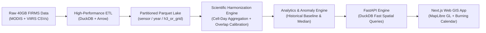
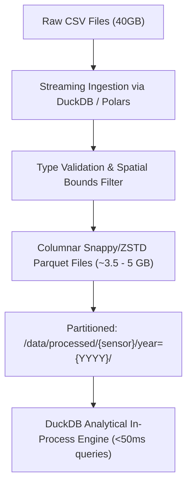
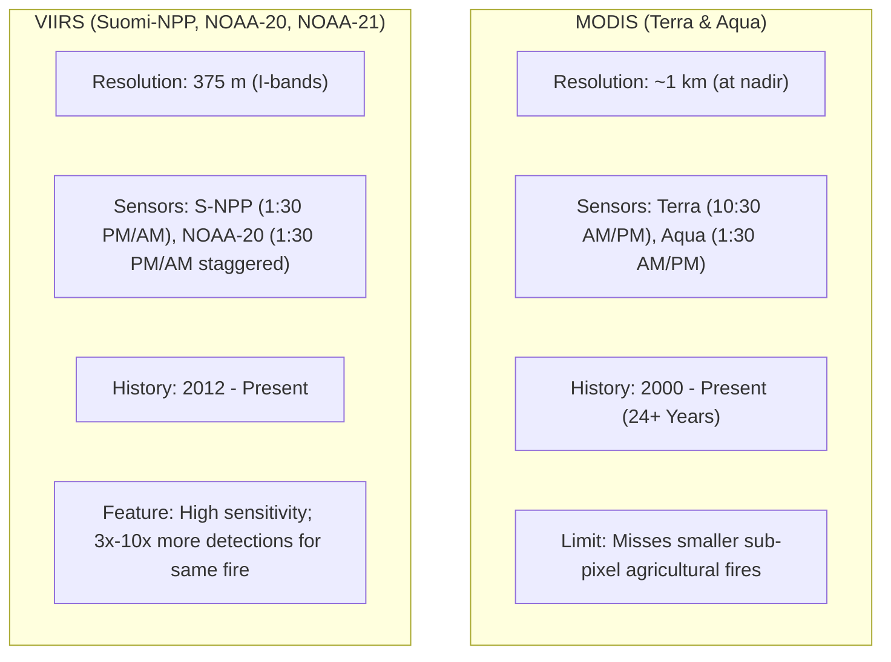
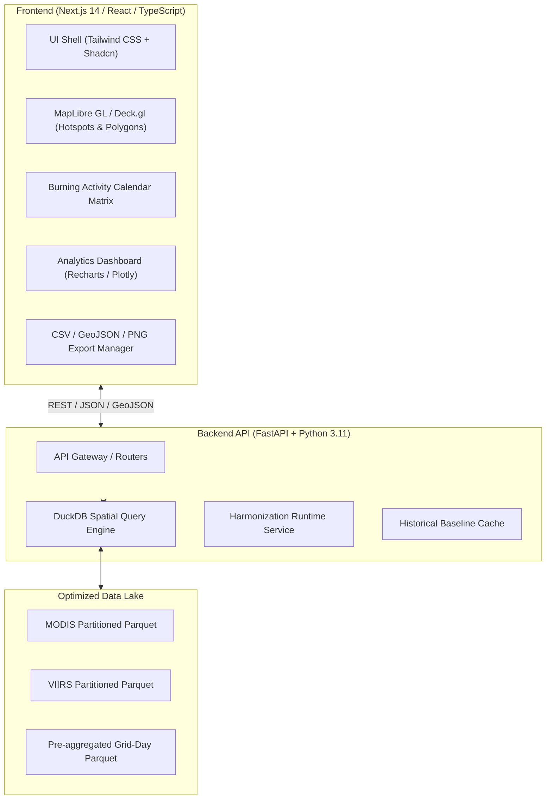
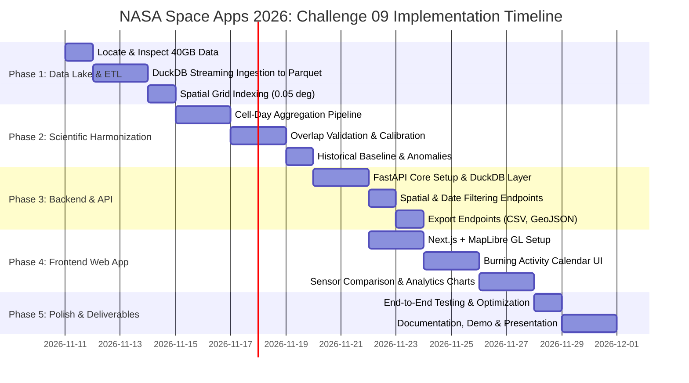

# NASA Space Apps Challenge 2026: Project Execution Plan
## Challenge 09: Harmonization of MODIS and VIIRS Hot Spots

---

## 1. Executive Summary & Challenge Context

| Attribute | Specification |
| :--- | :--- |
| **Challenge** | Challenge 09: Harmonization of MODIS and VIIRS Hot Spots |
| **Domain** | Earth Science, Remote Sensing, Big Data Engineering, Web GIS |
| **Core Objective** | Eliminate sensor-induced bias between MODIS (1 km) and VIIRS (375 m) to generate a seamless, 20+ year comparable fire activity baseline and an interactive Burning Activity Calendar web application. |
| **Target Dataset Scale** | **40 GB** NASA FIRMS Archive (MODIS Terra/Aqua, VIIRS S-NPP / NOAA-20 / NOAA-21) |
| **Initial Focus Scope** | MVP: Bangladesh & South Asia (2021–2025) $\rightarrow$ Scalable to Global Multi-Decadal (2000–2026) |



---

## 2. Big Data Strategy: Handling 40GB of Satellite Hotspots

A 40 GB dataset of NASA FIRMS CSV detections contains approximately **200 to 400 million hotspot records**. Loading this directly into memory using standard `pandas.read_csv()` will trigger out-of-memory (OOM) crashes.

### 2.1 Storage & Query Optimization



1. **Format Conversion**: Convert all CSVs to **Apache Parquet with Snappy compression**. Parquet's columnar format typically shrinks 40 GB FIRMS CSV data down to **~3.5 to 5 GB**, accelerating column scans by $10\times$ to $50\times$.
2. **Zero-Copy & Out-of-Core Processing**: Utilize **DuckDB** and **PyArrow** streaming readers to parse files in 100,000-row chunks without exceeding RAM limitations.
3. **Partitioning Scheme**:
   - `data/processed/modis/year=YYYY/month=MM/data.parquet`
   - `data/processed/viirs/year=YYYY/month=MM/data.parquet`
4. **Spatial Indexing**: Pre-calculate spatial grid IDs (discrete regular grid cells of $\approx 0.05^\circ \times 0.05^\circ$ or H3 discrete hexagonal indexes at resolution 7).

---

## 3. Scientific Harmonization Methodology

### 3.1 Understanding the Discrepancy



If raw counts are compared directly, transitioning from MODIS to VIIRS creates an artificial explosion in fire activity (Sensor Bias).

### 3.2 Harmonization Mathematics

To bridge the gap between detections and physical burning patterns, we implement a multi-stage harmonization pipeline:

#### Step 1: Spatial-Temporal Cell-Day Aggregation
We project individual hotspots into a common spatial grid $C_{i,j}$ (nominal size $0.05^\circ \approx 5.5 \text{ km}$) and daily temporal bins $t$:
$$\text{Cell-Day}(C_{i,j}, t) = \begin{cases} 1 & \text{if } \sum \text{Detections}(C_{i,j}, t) \ge 1 \\ 0 & \text{otherwise} \end{cases}$$
- **Why this works**: While VIIRS may trigger 15 detections across a large active burn where MODIS triggers only 2, both sensors confirm that cell $(i,j)$ burned on day $t$. This collapses spatial oversampling bias.

#### Step 2: Fire Radiative Power (FRP) Integration
In addition to binary incidence, we compute the maximum and integrated FRP per cell-day:
$$\text{FRP}_{\max}(C_{i,j}, t) = \max_{k \in \text{detections}} \text{FRP}_k$$

#### Step 3: Statistical Overlap Calibration (2012–2025)
During the mutual operational period (2012 to present), both MODIS and VIIRS observed the same regions. We compute empirical calibration models:
1. **Detection Probability Scaling**: For low-intensity agricultural fires where VIIRS detects fires below MODIS's minimum radiative energy threshold ($FRP < 10 \text{ MW}$), we calculate a conditional transfer function:
   $$\hat{N}_{\text{MODIS-equivalent}} = f(N_{\text{VIIRS}}, \text{FRP}_{\text{total}}, \text{LandCover})$$
2. **Quantile Mapping & Robust Regression**: Fit empirical cumulative distribution functions (ECDF) between MODIS and VIIRS monthly aggregations to normalize seasonal distribution amplitudes.

### 3.3 Overlap Validation Framework

We split the overlap period (e.g., 2012–2025) into calibration (2012–2020) and validation (2021–2025) sets to evaluate:
- **Pearson & Spearman Correlation ($r$)**: Goal $> 0.90$ between harmonized time series.
- **Root Mean Square Error (RMSE) & Mean Absolute Error (MAE)**.
- **Bias Ratio**:
  $$\text{Bias Ratio} = \frac{\sum \text{Harmonized VIIRS}}{\sum \text{MODIS Baseline}} \rightarrow 1.0 \pm 0.05$$

---

## 4. Analytics & Baseline Engine

### 4.1 Historical Baselines
- **Historical Median ($M_d$)**: For any given day of year $d$ or month $m$, calculate the 50th percentile across all historical baseline years.
- **Historical Interquartile Range (IQR)**: 25th percentile ($Q_1$) to 75th percentile ($Q_3$) representing normal seasonal bounds.
- **Historical Average ($\mu$) and Standard Deviation ($\sigma$)**.

### 4.2 Anomaly Classification
For any selected observation window, calculate the Fire Anomaly Index:
$$\text{Anomaly Ratio} = \frac{\text{Current Harmonized Activity}}{\text{Historical Median Activity}}$$
$$Z\text{-score} = \frac{X_{\text{current}} - \mu_{\text{historical}}}{\sigma_{\text{historical}}}$$

| Anomaly State | Z-Score / Ratio Condition | Map / UI Color Code |
| :--- | :--- | :--- |
| **Significantly Below Normal** | $Z < -1.5$ or Ratio $< 0.5$ | Soft Blue / Cyan (`#38bdf8`) |
| **Normal Fire Activity** | $-1.0 \le Z \le +1.0$ | Neutral Slate / Green (`#22c55e`) |
| **Elevated Fire Activity** | $+1.0 < Z \le +2.0$ | Amber / Orange (`#f59e0b`) |
| **Extreme Fire Anomaly** | $Z > +2.0$ or Ratio $> 2.0$ | Vivid Crimson / Red (`#ef4444`) |

---

## 5. Web Application Architecture



### 5.1 Interactive UI Components
1. **Interactive Fire Map**:
   - Vector Tile / GeoJSON rendering of Raw Hotspots vs Harmonized Grid Cells.
   - Polygon Drawing tool (Freehand & Bounding Box) for arbitrary AOI selection.
   - Pre-loaded Administrative Boundaries (Bangladesh Divisions/Districts, South Asia countries).
2. **Burning Activity Calendar**:
   - A Github-style or Heatmap Matrix (Months on Y-axis, Days on X-axis or Years vs Months).
   - Dynamic coloring with accessible color ramps (ColorBrewer Viridis / Plasma / Inferno).
   - Tooltip details: Date, Active Cell-Days, FRP Max, Historical Median comparison.
3. **Sensor Comparison Tab**:
   - Split-screen or overlay comparison: Raw MODIS vs Raw VIIRS vs Harmonized Activity.
   - Proves clearly to NASA judges how the harmonization eliminates the sensor artifact jump.
4. **Export Center**:
   - Instant filtering download: Filter by date range + AOI polygon $\rightarrow$ CSV, GeoJSON, Parquet.
   - High-res summary report generation (PNG / PDF summary).

---

## 6. Phased Implementation Roadmap



### Detailed Breakdown of Work Packages

| Phase | Milestone | Primary Deliverable | Key Tech |
| :--- | :--- | :--- | :--- |
| **Phase 1** | **ETL & Data Lake** | Ingest 40GB CSVs $\rightarrow$ Partitioned Snappy Parquet. Spatial indexing. | Python, DuckDB, PyArrow |
| **Phase 2** | **Harmonization Engine** | Cell-Day spatial aggregator, Overlap validation (2012–2025), Sensitivity calibration. | DuckDB, NumPy, SciPy |
| **Phase 3** | **Analytics Engine** | 20-year Historical Median, IQR, Mean, Z-score Anomaly calculation per Grid/Region. | DuckDB SQL, Pandas |
| **Phase 4** | **Backend API** | High-speed REST endpoints (`/api/hotspots`, `/api/calendar`, `/api/stats`, `/api/export`). | FastAPI, Uvicorn, DuckDB |
| **Phase 5** | **Frontend UI & Map** | Interactive Map with AOI polygon drawing, satellite hotspot visualization. | Next.js, MapLibre GL, Tailwind |
| **Phase 6** | **Calendar & Dashboard** | Burning Activity Calendar, Historical comparison graphs, sensor comparison switch. | Recharts, Lucide, Radix UI |
| **Phase 7** | **Export & Methodology** | Filtered CSV/GeoJSON export, scientific documentation tab explaining harmonization. | FastAPI Streaming, Markdown |
| **Phase 8** | **Validation & Submission** | Rigorous QA, performance benchmarking, demo recording, and submission README. | Pytest, GitHub |

---

## 7. Project File & Directory Structure

```
NASA_SPACE_APP/
├── data/
│   ├── raw/                      # Original CSV files (or symbolic links to 40GB external storage)
│   │   ├── modis/
│   │   └── viirs/
│   ├── processed/                # Partitioned columnar Parquet store (~4 GB)
│   │   ├── modis/
│   │   ├── viirs/
│   │   └── harmonized_cell_days/
│   └── reference/                # GeoJSON boundaries (Bangladesh districts, South Asia)
│
├── engine/                       # Python Scientific Harmonization & Analytics Engine
│   ├── etl/
│   │   ├── convert_csv_to_parquet.py
│   │   └── spatial_grid.py
│   ├── harmonization/
│   │   ├── cell_day_aggregator.py
│   │   ├── overlap_calibration.py
│   │   └── validation_metrics.py
│   └── analytics/
│       ├── historical_baseline.py
│       └── anomaly_detector.py
│
├── backend/                      # FastAPI Application
│   ├── app/
│   │   ├── main.py
│   │   ├── api/
│   │   │   ├── hotspots.py
│   │   │   ├── calendar.py
│   │   │   ├── analytics.py
│   │   │   └── export.py
│   │   ├── core/
│   │   │   ├── config.py
│   │   │   └── db.py            # DuckDB connection pool
│   │   └── services/
│   └── requirements.txt
│
├── frontend/                     # Next.js 14 / React Web Application
│   ├── src/
│   │   ├── components/
│   │   │   ├── map/             # MapLibre GL interactive viewer & AOI drawing
│   │   │   ├── calendar/        # Burning Activity Calendar heatmap matrix
│   │   │   ├── charts/          # Historical Median & Anomaly comparison charts
│   │   │   └── ui/              # Accessible design system components
│   │   ├── pages/ or app/
│   │   └── lib/
│   └── package.json
│
├── docs/                         # Methodology, validation papers & documentation
│   └── harmonization_methodology.md
└── README.md
```

---

## 8. Critical NASA Judging Alignment

To maximize scores from NASA Space Apps Challenge judges:
1. **Scientific Rigor over Superficial Visuals**: We explicitly demonstrate understanding that a single hotspot $\neq$ single fire event. The methodology tab will clearly publish the validation metrics (RMSE, $R^2$, Overlap ratio) proving the math works.
2. **Speed & Usability on Big Data**: Processing 40GB with sub-second response times in the web UI will dramatically impress judges compared to slow, crashing prototypes.
3. **Accessibility & Color Ramps**: Calendar and map visualizations will follow ColorBrewer standards (colorblind safe, perceptually uniform) so that severity is immediately understandable.
4. **Actionability for Stakeholders**: Forestry departments, disaster response agencies, and climate scientists can immediately download custom AOI CSVs and view fire anomalies against a 20-year baseline.
